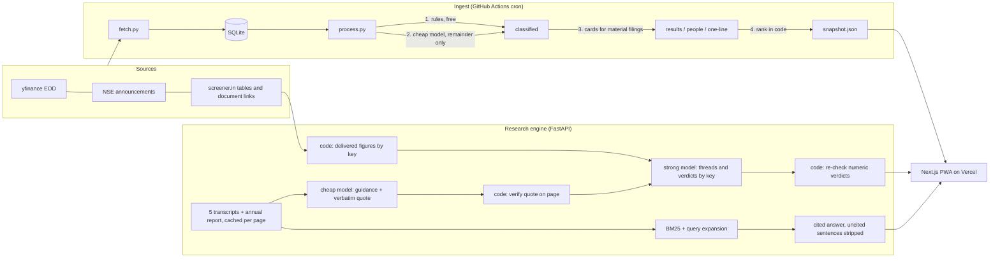

# FINN

A mobile-first investment agent that filters. Across a portfolio of 20 NSE stocks it
surfaces the few filings that matter, says why in one line, and buries the rest. On
demand, it researches any NSE ticker from the company's own annual report and concall
transcripts, and checks what management promised against what it delivered.

**Live demo:** https://enam-ai-engineer-assignment.vercel.app/ (open on a phone; no login)


Built for the ENAM Holdings AI Engineer Build Challenge, 8–15 November 2026.

## What to try in two minutes

1. **Brief** (home). Tap **7 days**. Each card says what happened, the number, and where it
   came from. Tap the score to see why it is ranked there. Expand "routine filings hidden".
2. **A results card.** Revenue, EBITDA, PBT and PAT with QoQ and YoY, read from the filing
   PDF and reconciled against screener.in; the note under the table says which.
3. **Alerts.** Drag the volume and price sliders; alerts re-evaluate as you drag.
4. **Research → KPITTECH → Promises.** "We will be in a position to maintain 21% EBITDA"
   (Q2 FY26 call, p.5) against a delivered 18.9%: Missed. Tap "What management said" for the
   quote and the page link.
5. **Research → DIXON.** A FY27 telecom revenue target cut from ₹7,500–8,000 cr to
   ₹6,700–7,000 cr one call later: Moved the goalposts.
6. **Ask FINN** on any researched company. Every sentence carries its source page; ask
   something the filings cannot answer and it says "Not disclosed in the sources."

## The product point of view

An investor's scarce resource is attention, so FINN is organised around what it leaves out.

- **The Brief ranks, then hides.** In the last 7 days of the snapshot, 65 filings became 15
  cards and one collapsed row. Same-day filings about one event (results, the deck, the
  newspaper ad) fold into one card.
- **Triage is feedback.** Seen, Star and "Mute this type for this company" are stored on the
  device and change the ranking.
- **Every rank is explained.** Category weight × paperwork demotion × seniority of the person
  × whether the stock reacted × size of the amount. The reasons are on the card.
- **Research is about management, not a summary of management.** The Promise Tracker follows
  each target across five calls and gives a verdict: Delivered, Missed, Moved the goalposts,
  Quietly dropped, In progress, or Not verifiable.
- **Primary sources only on the pull side.** Annual report, transcripts, and figures computed
  from reported financials. No news, no broker notes, no model memory of the company.

## Architecture



- **`frontend/`** Next.js (App Router), Tailwind, installable PWA. It ships the snapshot and
  the pre-built research files as static assets, so every screen except Ask FINN and
  first-time research works with no backend at all.
- **`backend/finn/`** sources, rule classifier, ranking, alerts, results maths, the model
  router, and `research/` (financials, corpus and retrieval, promises, narrative, ask).
- **`ingest/`** `fetch.py`, `process.py` (the Brief) and `research.py` (per-ticker research).
- **`evals/`** hand-labelled classifier sample and its runner.

### Decisions that shaped it

| Decision | Why |
|---|---|
| Rules first, model only for what rules cannot place | 236 of 271 filings (87%) are placed by regex over the exchange's own category and subject, for free. |
| All arithmetic in code | Growth, margins, EBITDA, thresholds and ranking are never produced by a model. |
| A results card must reconcile with screener.in in all three quarters | 4 of 15 filing-parsed cards did not reconcile (a wrong revenue line or prior-period figure). If revenue, PBT or PAT disagree, the card falls back to screener's table and says why. |
| The model may only point at delivered figures by key | It writes `{FY26.ebitda_margin}`; code fills in 18.9%. A delivered number cannot be hallucinated. |
| Every guidance quote is verified against its page in code | A statement whose quote cannot be found in the transcript is dropped. |
| BM25 instead of embeddings | Filing questions are keyword-heavy, a page is the unit of citation, and BM25 needs no model, download or quota. A cheap model expands the query to cover synonyms. |
| The snapshot ships with the frontend | No cold start for the Brief, and the demo survives a source or backend outage. The window ends at the last successful fetch and says so. |
| NSE, not BSE, for announcements | BSE's announcements API refused both a plain and a browser-like request; NSE's documented cookie flow works. |

## Model routing and cost

One router (`backend/finn/llm.py`) handles every model call: tier per task, response cache
keyed by task and prompt, retry with backoff, fallback from the strong to the cheap model
when the strong one is overloaded or out of quota, and a token and cost log.

| Task | Tier | Model | Per unit, list price |
|---|---|---|---|
| Classify ambiguous filings (subject only, 25 per call) | cheap | gemini-3.5-flash-lite | $0.00007 per filing |
| One-line summary of a material filing | cheap | gemini-3.5-flash-lite | $0.0006 |
| Results line items off the P&L page | cheap | gemini-3.5-flash-lite | $0.0016 |
| Who joined or left, with the filing's own profile | cheap | gemini-3.5-flash-lite | $0.0008 |
| Guidance statements from one transcript | cheap | gemini-3.5-flash-lite | $0.006 |
| Search phrasings for a question | cheap | gemini-3.5-flash-lite | $0.0001 |
| Promise threads and verdicts, per company | strong | gemini-3.5-flash | $0.06 ($0.005 on fallback) |
| Business snapshot, bull and bear, per company | strong | gemini-3.5-flash | $0.04 ($0.005 on fallback) |
| Ask FINN, per question | strong | gemini-3.5-flash | $0.016 |

**Everything in this repository so far** (271 filings processed, six companies researched,
all testing): 936,024 tokens, **$0.78 at list price, ₹0 actually spent**, all on Gemini's
free tier. Researching a new company costs about 100,000 tokens, roughly $0.04–0.14 at list
price, and takes one to two and a half minutes once; after that it is a file read.

List prices are from Google's pricing page on 11 Nov 2026 (the 3.5 Flash price is inferred
from Google's 3.6 release note). The free tier allows only 20 requests a day on the strong
model, so in practice most strong-tier work in the demo ran on the cheap model through the
fallback. The verdicts that can be checked numerically are re-checked in code either way.

## Classifier evaluation

70 real filings from the portfolio, sampled with a fixed seed (50 placed by rules, 20 left
for the model) and labelled by hand from the filing itself where the subject line was
uninformative. Run `python evals/run_eval.py`.

| Pipeline | Accuracy |
|---|---|
| Rules only (a filing the rules cannot place counts as wrong) | 43 / 70 = 61.4% |
| Rules + cheap model (shipped) | 57 / 70 = **81.4%** |
| Precision of rules on what they place | 43 / 50 = 86.0% |
| Model on its 20 | 14 / 20 = 70.0% |

Of the 13 misses, 6 are filings whose subject says nothing ("Outcome of the Board Meeting",
"Copy of Newspaper Publication"); the truth is only in the PDF, which classification does
not read by design. The rest are fixable rules (a press release about results should be
`results`; an ESG rating is not a credit rating). I left the rules as they were when
measured rather than tune them on the test set. The labels were drafted with the coding
agent and are in `evals/labelled.csv` for inspection.

## Run it locally

```bash
python -m venv .venv && .venv/Scripts/pip install -r backend/requirements.txt   # macOS/Linux: .venv/bin/pip
cp .env.example .env                                  # optional: add GEMINI_API_KEY
.venv/Scripts/python ingest/fetch.py && .venv/Scripts/python ingest/process.py   # optional: refresh data
cd backend && ../.venv/Scripts/python -m uvicorn app:app --port 8000            # optional: research engine
cd frontend && npm install && npm run build && npm start                        # http://localhost:3000
```

Only the last command is needed to see the app: it runs from the committed snapshot and
research files. For Ask FINN and first-time research, start the backend and put
`NEXT_PUBLIC_API_URL=http://localhost:8000` in `frontend/.env.local`.

- Research a ticker from the command line: `python ingest/research.py TATAPOWER`
- Tests (77, all offline): `cd backend && python -m pytest -q`
- Check which models a key can reach: `cd backend && python -m finn.llm --check`

## Deployment

- **Frontend:** Vercel, root directory `frontend`, redeployed on every push to `main`.
- **Backend:** `render.yaml` is a Render blueprint (free tier). Set `GEMINI_API_KEY` there
  and `NEXT_PUBLIC_API_URL` on Vercel.
- **Scheduled ingestion:** `.github/workflows/ingest.yml` refreshes the snapshot after the
  close and three more times a day, and commits it; the database and document cache persist
  between runs so nothing is processed twice. It needs a `GEMINI_API_KEY` repository secret.

## Known limitations

- **Sources can block cloud IPs.** NSE and BSE are reachable from a laptop; from GitHub or
  Render they may refuse. Ingestion then keeps the previous snapshot, and live research for
  a new ticker reports the failure. The six pre-built companies always work.
- **Two results PDFs cannot be read.** HDFC Bank's file is truncated on NSE's own server and
  Deepak Nitrite's is an image-only scan; both cards use screener's table and say so. There
  is no OCR.
- **Segment and constant-currency targets are "Not verifiable".** Delivered figures come
  from standardised company-level financials, so a target for one segment, in USD, or in
  constant currency is shown with its quotes but not scored.
- **Background on a new executive comes only from the filing.** SEBI requires a profile for
  appointments, and FINN shows it when present. The web-search enrichment is not built.
- **Push is in-app.** There is no Telegram or web-push channel, and no voice query.
- **Free-tier limits.** The strong model's 20 requests a day runs out quickly; the fallback
  keeps the app working on the cheap model.
- **Stale snapshot between ingestion runs.** The Brief is as fresh as the last committed
  snapshot; its header shows the exact window.
- **Single user.** Preferences live in the browser; there are no accounts.

## More

- [docs/WRITEUP.md](docs/WRITEUP.md): the covering note.
- [docs/BUILD_LOG.md](docs/BUILD_LOG.md): decisions, dead ends and fixes, session by session.
- [docs/AI_HISTORY.md](docs/AI_HISTORY.md): the AI sessions used to build this, with exports.
